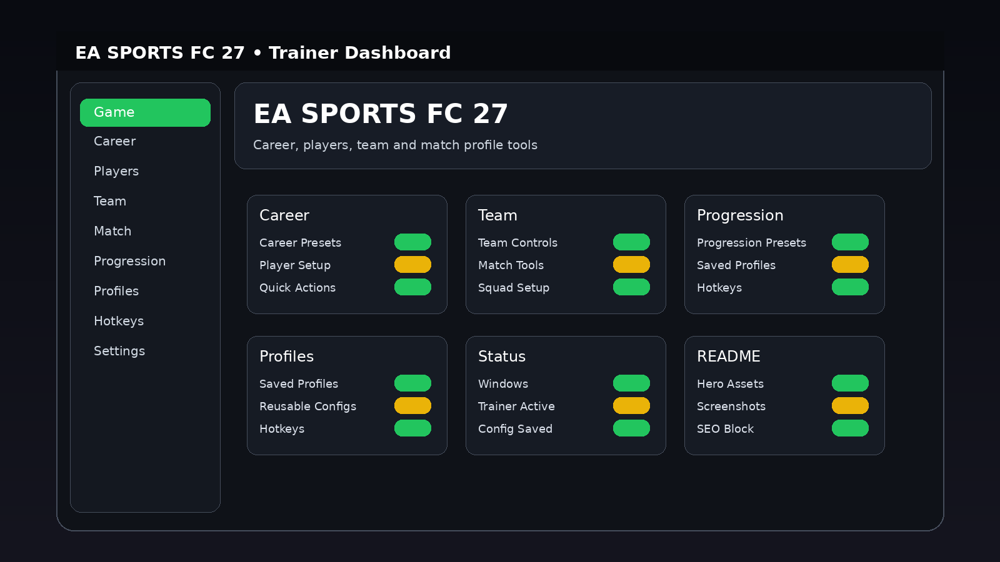

# EA SPORTS FC 27 Trainer — Game Enhancer for Windows

   

---

EA SPORTS FC 27 Trainer is a Windows desktop utility built for players who want their setup dialed in before the whistle blows. It pairs a game-specific dashboard with reusable profiles and configurable hotkeys, so your career, team, and progression options stay organized and one tap away. Every control lives in a clean, purpose-built interface instead of buried menus, and saved profiles let you reload the exact same configuration session after session. If you play FC 27 on PC and want fast, repeatable access to your settings, this trainer is built for that job.

## Features

### Career
- **Career Presets** — ready-made configurations for season and manager modes, selectable straight from the dashboard.
- **Player Setup** — tune individual player parameters without digging through menus mid-session.
- **Quick Actions** — one-click toggles for the tweaks you reach for most often.

### Team
- **Team Controls** — manage club-level settings from a single panel built around fast switching.
- **Match Tools** — keep match-day options grouped and accessible so nothing interrupts your flow.
- **Squad Setup** — organize squad configurations and reuse them across sessions.

### Progression
- **Progression Presets** — save and reload progression-oriented setups in seconds.
- **Saved Profiles** — every configuration can be stored, named and recalled without re-entering values.
- **Configurable Hotkeys** — bind any action to the keys you actually use, and the trainer remembers them.

### Compatibility
- **Platform:** Windows PC only
- **Interface:** Desktop dashboard with game-specific visuals
- **Profiles:** Reusable and fully supported
- **Hotkeys:** Configurable per profile
- **Presets:** Supported across all option groups

### Built for the Long Haul
- **Profile manager** — switch between saved setups instantly instead of rebuilding from scratch.
- **Dashboard visuals** — a game-specific layout that reads clean at a glance.
- **No bloat** — every control is organized around how you actually play, not a wall of toggles.

## How It Works

The trainer runs as a standalone Windows desktop app that sits alongside EA SPORTS FC 27. No scripts to wire up, no game files to patch — launch the dashboard, pick your profile, and the options you toggle are organized into game-specific groups like Career, Team, and Progression so you're not hunting through menus mid-session.

Everything you configure is stored in reusable profiles. Dial in a setup once, save it, and reload it whenever you want that exact configuration again — no rebuilding from scratch. Hotkeys are fully configurable, so you bind the actions you actually use to keys that fit your keyboard and your hands.

The interface is built around the way you actually play: a game-specific dashboard with quick presets, saved profiles front and center, and option groups that mirror FC 27's own structure. Switch profiles between matches, tweak a setting on the fly, save it back — the trainer keeps up without breaking your flow.

## Supported Games

**EA SPORTS FC 27** on Windows PC — that's the target, and the trainer is built tight around it. No bloat for other platforms, no half-supported side modes.

- **EA SPORTS FC 27 (Windows PC)** — full support for the desktop dashboard, reusable profiles, configurable hotkeys and game-specific option groups.
- **Career mode** — career presets, player setup and quick actions map cleanly onto the Career flow.
- **Team management** — team controls, match tools and squad setup are wired for the Team side of the game.
- **Progression systems** — progression presets, saved profiles and hotkeys stay consistent across sessions.

Platform support is Windows PC only — that's the whole scope, and it's fully covered. Profiles and hotkeys carry across every supported mode, so a setup you build for Career works the same way when you switch to Team or Progression tools.

If it's EA SPORTS FC 27 on Windows, the trainer has you covered.

## Configuration

Profiles carry your setup between sessions — build one, tune it, reuse it. Config lives in three places: the profile layer, the hotkey map, and the per-session overrides.

**Profiles**
- **Default** — baseline config, loads on first launch.
- **Gameplay** — general match setup.
- **Progression** — career and progression-oriented settings.
- **Utility** — reusable utility loadout.
- **Custom** — anything you save yourself; the trainer writes it back exactly as configured.

Save a profile after you dial in the options you want, and the dashboard reloads those exact values next time you pick it.

**Hotkeys**
Every action in the dashboard is bindable. Open the hotkey editor, pick the action, press the key combo, confirm — the binding is stored per profile, so your Gameplay profile and your Progression profile can run different layouts without conflicts. Rebinding is instant and takes effect the next time the trainer is focused.

**Presets and per-session overrides**
Presets are the fast lane: pick one, and the relevant option groups snap into place. Anything you flip manually on top of a preset stays as a session override until you either save it into the profile or reload the preset. No hidden state — what the dashboard shows is what's active.

**Where config lives**
Settings are stored alongside the trainer as profile files. Copy them to another Windows machine and the trainer picks them up on launch; delete one and the dashboard falls back to the corresponding default. Nothing is written into the game install.

## FAQ

**Does this work with EA SPORTS FC 27 on Windows?**

Yes. The trainer is built specifically for EA SPORTS FC 27 on Windows PC. No other platform is supported.

**Can I save my setup between sessions?**

Absolutely. Profiles are reusable — configure your options once, save the profile, and reload it whenever you want the same configuration.

**Are the hotkeys fixed?**

No. Hotkeys are fully configurable, so you can map actions to whatever keys fit your setup.

**What's the difference between a profile and a preset?**

A preset is a ready-made option group for a specific use case. A profile is your saved configuration — you can build one from presets or from scratch. Both are built for quick access from the dashboard.

**Do I need to reconfigure everything each launch?**

Nope. That's the point of saved profiles. Load a profile and you're back in business in seconds.

**Is there a default configuration to start from?**

Yes — the Default profile gives you a base setup. From there, Gameplay, Progression, Utility, or a Custom profile cover most scenarios.

**Can I switch configurations mid-session?**

Yes. Profiles are designed to be swapped quickly from the trainer interface without restarting anything.

**How do I get the current version?**

Use the Download buttons in this README to grab the latest Windows package.

**Where do I find my saved profiles?**

They're managed through the trainer interface — load, save, and organize them from the dashboard.

**Does it support multiple profiles at once?**

You can keep multiple profiles saved and switch between them. One active profile at a time keeps things clean.

## Disclaimer

Read this before you run it. EA-SPORTS-FC-27-Trainer is a third-party desktop utility for Windows PC — it is not published, endorsed, sponsored, or approved by EA, and it is not an official EA SPORTS FC 27 product. Everything here is offered as-is, for personal and educational use, with no warranty of any kind: no guarantee of stability, no guarantee of compatibility with any specific game build or patch, and no guarantee of results.

You are responsible for how you use it. That means understanding your local rules, the game's terms of service, and any online or competitive environment you play in. Use it offline or in single-player contexts where third-party tools are permitted. Do not expect it to work around anti-cheat, and do not treat a trainer as a license to break rules online — that's on you, not on this project.

Back up your saves and profiles before you start. Trainer-style tools touch game memory and configuration, and while this project is built to be careful, no tool is risk-free. If something breaks, you restore from your backup, not from this README.

The software is provided "as is", without express or implied warranties including merchantability or fitness for a particular purpose. In no event shall the authors or contributors be liable for any claim, damages, or other liability arising from, out of, or in connection with the software or its use. Run it at your own risk, keep it updated, and if a version doesn't match your game build, wait for an update instead of forcing it.

